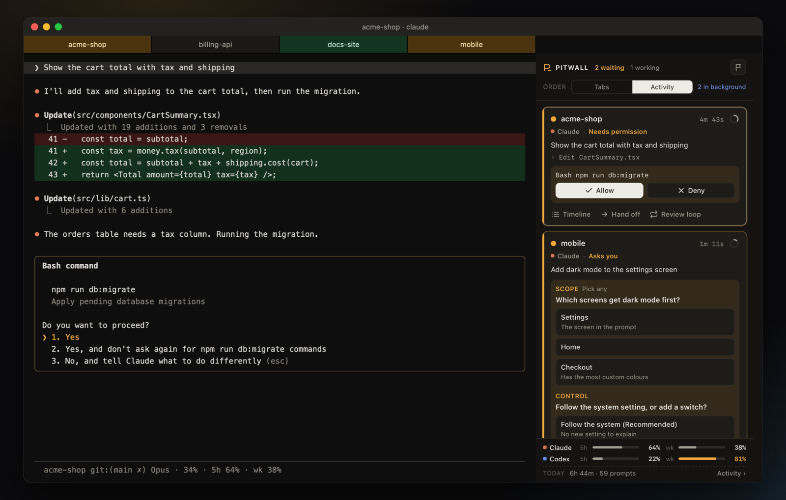
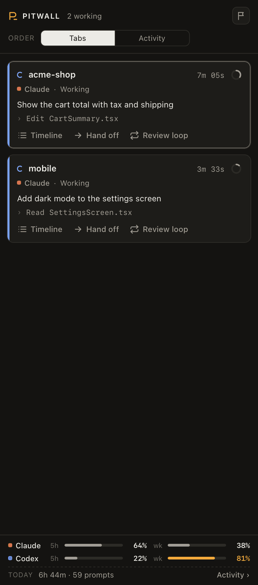
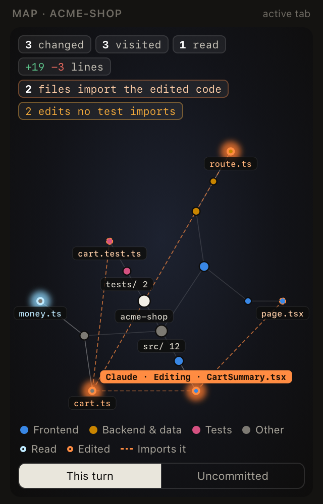

<h1 align="center">Pitwall</h1>

<p align="center"><b>A pit wall for your coding agents, inside iTerm2.</b><br>
See every Claude Code and Codex session at once. Answer them without switching tabs.</p>

<p align="center">
<a href="https://github.com/vvojciech/pitwall/actions/workflows/test.yml"></a>
<a href="https://github.com/vvojciech/pitwall/releases/latest"></a>

<a href="LICENSE"></a>
</p>

<p align="center"></p>

```sh
curl -fsSL https://raw.githubusercontent.com/vvojciech/pitwall/main/install.sh | bash
```

<p align="center">Free and open source. Runs on your Mac only: no account, no server, no telemetry.</p>

## Why

Three agents in three tabs is a lot to keep track of. One sits on a permission prompt for twenty
minutes because you were in another tab. One finished a while ago and you missed it. One changed
files you have not looked at yet.

Pitwall puts all of them in one panel next to your terminal, and tells you which one needs you.

<table>
<tr>
<td width="46%"></td>
<td>

### Steer from one place

**Allow or Deny** a permission prompt from the card. The agent keeps going in its own tab.

**Answer Claude's questions** on the card. One click for a single choice. Pick several and press Send for the rest.

**Undo a turn.** Pitwall takes a snapshot before every prompt. If a turn goes wrong, see the files it touched and put them back. Changed your mind? Redo.

**Hand off** a task with its diff and failed commands to a fresh Claude or Codex.

**Review loops.** A second agent reviews the first one's work, round after round, until it says APPROVED.

**Agent races.** Give one task to several agents, each in its own git worktree, and keep the best diff.

</td>
</tr>
</table>

<table>
<tr>
<td>

### See what each agent is doing

**One card per agent**, in tab order or with the ones that need you first. State, task, last action and a timer. Click a card to jump to that pane.

**Tab colours.** A tab turns dark amber when its agent waits for you, dark green when it finishes and dark red when it fails.

**Context ring.** How full each agent's context window is, amber from 80%, red from 90%.

**Background work.** Shells, sub-agents and monitors that still run after a turn ends.

**Code map** of the active tab's work: files read, files edited, the file it is on now, and the files that import an edit, with a warning when no test covers it.

**Plan limits** for Claude and ChatGPT, pinned to the bottom, and an activity page with time, prompts and tokens per day and per project.

</td>
<td width="42%"></td>
</tr>
</table>

### And the small things

- **Failed commands.** A command fails in a shell tab: send it to the agent in that project in
  one click.
- **Busy ports.** `EADDRINUSE`? The panel names the process on the port and can stop it.
- **Shared memory.** Codex starts with Claude Code's notes for the project, and Claude Code
  starts with Codex's.
- **Rename agents.** Double-click a name. The tab takes the same name.

<p align="center"></p>

## Install

You need macOS, [iTerm2](https://iterm2.com) 3.6 or newer, Python 3.9 or newer and git. Pitwall
works with [Claude Code](https://claude.com/claude-code), [Codex](https://github.com/openai/codex)
or both.

```sh
curl -fsSL https://raw.githubusercontent.com/vvojciech/pitwall/main/install.sh | bash
```

The installer puts the code in `~/.pitwall/app`, links `pitwall` into `~/.local/bin`, and runs
`pitwall install`. To install from a clone instead:

```sh
git clone https://github.com/vvojciech/pitwall.git && cd pitwall && bin/pitwall install
```

Then:

1. In iTerm2, open **Settings > General > Magic** and turn on **Enable Python API**, if
   `pitwall doctor` says it is off. The first time Pitwall connects, iTerm2 asks whether to
   allow it. Click **Allow**. Until you do, `pitwall doctor` reports that the service does not
   answer.
2. Open **View > Show Toolbelt**, then select **Toolbelt > Pitwall**.
3. Start Codex once and approve Pitwall's hooks. Codex asks for every new hook.
4. Optional: install iTerm2's shell integration (**iTerm2 > Install Shell Integration**) to
   catch failed commands. Open new tabs after you install it.

## Commands

| Command | What it does |
|---|---|
| `pitwall install` | Make the venv, add the hooks, start the service |
| `pitwall update` | Pull the newest version and install it again |
| `pitwall doctor` | Check each part of the setup and say how to fix it |
| `pitwall activity` | Open the activity page |
| `pitwall uninstall` | Remove the hooks and the status line wrapper, and stop the service |

## What install changes on your Mac

| Change | Undo |
|---|---|
| Adds 10 hooks to `~/.claude/settings.json` and 7 to `~/.codex/hooks.json`. Your other hooks stay. A backup is written next to each file it changes. | `pitwall uninstall` |
| Wraps your Claude Code status line command. The wrapper saves its input (which holds the plan limits) to `~/.pitwall/`, then runs your command with the same input, so the status line looks the same. | `pitwall uninstall` puts your command back |
| Adds the LaunchAgent `com.vvojciech.pitwall`, which runs the service from `~/.pitwall/venv`. | `pitwall uninstall` |
| Keeps state, logs and caches in `~/.pitwall/`. | Delete the folder |

Settings: `PITWALL_SHARED_MEMORY=0` turns off shared memory. Set it in the environment that
starts your agents.

## How it works

<details>
<summary>Hooks, a local service and a web panel</summary>

1. Claude Code and Codex run `pitwall hook <agent> <event>` on each hook event. The hook reads
   `ITERM_SESSION_ID` to know its pane, sends the event to the service and exits. It never
   blocks or fails the agent, and it prints nothing but the shared memory at session start.
2. The service holds the agent state, serves the panel on `127.0.0.1`, and acts on iTerm2
   through its Python API: tab colours, keyboard focus, screen reads and keystrokes.
3. The panel is a web page that iTerm2 shows in its toolbelt. It asks the service for the
   state every second.

</details>

## Security and privacy

- **Nothing leaves your Mac.** There is no account, server or telemetry. Usage numbers come from
  the transcripts that Claude Code and Codex already keep on disk.
- **Only you can use the service.** It listens on `127.0.0.1` only. It makes a new random token
  at each start and refuses each request without it. The token is in `~/.pitwall/daemon.json`,
  which only your user can read, so a web page or another user cannot drive your agents.
- **Keystrokes need the matching screen.** Allow, Deny, Trust and question answers send keys only when Pitwall sees
  the expected menu on screen with the expected option selected. Messages to an agent are never
  typed during its turn.
- **Stop asks first, and checks again.** Stopping a process asks for a confirmation, and Pitwall
  checks that the process still holds the port.

Found a security problem? Open a private security advisory on GitHub.

## Troubleshooting

<details>
<summary>Common problems and fixes</summary>

| Problem | Fix |
|---|---|
| The panel says "Pitwall is not running" | Run `pitwall doctor`. Read `~/.pitwall/daemon.log`. |
| An agent has no card | It appears within 5 seconds of starting, or at its first hook event. Check `pitwall doctor` for the hooks. |
| Allow says the prompt is not on screen | Open the tab and answer there. Pitwall answers only the first option of a visible menu. |
| A question says the menu is part answered | Someone moved in the menu in the tab. Finish the answer in the tab. |
| No Claude plan limits | They appear after the next Claude Code reply, when the status line runs. |
| Failed commands never show | Install iTerm2 shell integration, then open a new tab. |
| A Codex card never shows | Approve Pitwall's hooks the next time Codex starts. |
| Codex never shows Allow and Deny | Codex asks only when its approval settings send the request to you. With `approvals_reviewer = "auto_review"`, Codex decides by itself. |
| The panel is on the right | iTerm2 always docks the toolbelt on the right. Set **Settings > Appearance > General > Tab bar location** to **Left** for a vertical tab list with status dots. |

</details>

## Limits

- macOS and iTerm2 only.
- Undo works in git repositories only.
- The code map reads imports for JavaScript, TypeScript and Python.
- Notifications have no Allow or Deny buttons.
- The activity page opens in your browser.

## Development

<details>
<summary>Tests, the demo server and a second service</summary>

```sh
python3 -m unittest              # no network, no iTerm2 needed
python3 scripts/demo.py          # the UI with invented data, on http://127.0.0.1:47821/?t=demo
```

A second service for a test needs its own state folder, and must stay off the toolbelt:

```sh
PITWALL_HOME=/tmp/pw PITWALL_NO_TOOLBELT=1 PYTHONPATH=. ~/.pitwall/venv/bin/python -m pitwall.daemon
```

The code is plain Python 3.9 and plain JavaScript, with no build step and one dependency (the
`iterm2` package, in the service's venv only). See [CHANGELOG.md](CHANGELOG.md) and
[ROADMAP.md](ROADMAP.md).

</details>

## License

MIT
