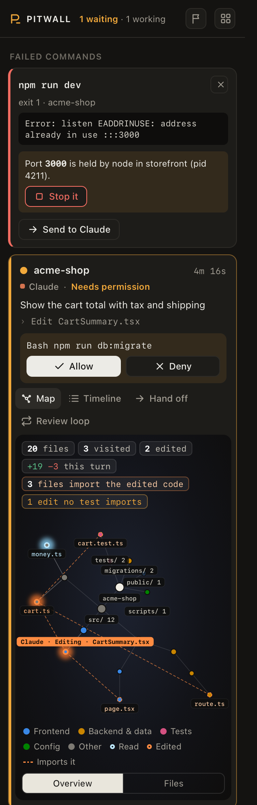
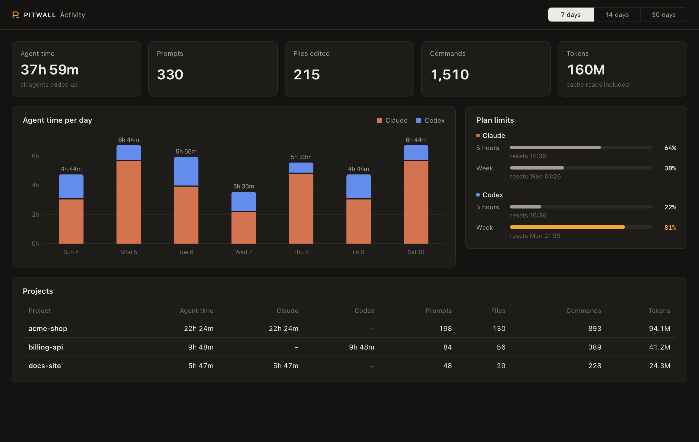

# Pitwall

[](https://github.com/vvojciech/pitwall/actions/workflows/test.yml)

Watch and steer Claude Code and Codex from iTerm2. Pitwall adds a panel to the iTerm2 window
that follows every agent in every tab: what it does, what it needs from you, what it changed,
and how much of your plan it used.

<p align="center"></p>

Pitwall is not a fork of iTerm2. It is a small local service that talks to iTerm2 through the
iTerm2 Python API, and to the agents through the hooks that Claude Code and Codex already have.
The idea comes from [GhosttyEXTREME](https://github.com/steventsvik/GhosttyEXTREME), which does
this for Ghostty.

## What it does

**See every agent**

- **Agent panel.** One card per agent, in the order of your iTerm2 windows, tabs and panes, or
  with the agents that need you first (the Tabs and Activity switch at the top):
  project, state (working, needs permission, waiting for you, done, failed), task, last action
  and a timer. Click a card to go to that pane. Double-click its name to rename it; the tab
  takes the same name. Plan usage stays pinned to the bottom of the panel.
- **Background work.** When a Claude Code turn ends with work still running (a background shell,
  a sub-agent, a monitor or a scheduled wake-up), the card lists it, and the header counts it.
- **Tab signals.** A tab turns amber when its agent waits for you, and green or red when it
  finishes or fails, until you look at it.
- **Code map.** A map of the work of the agent in your active tab, not of the whole project: the
  files it read and edited, the file it works on now, and the files that import an edit (with a
  warning when no test imports it). "This turn" counts what changed since the last prompt, also
  through shell commands; "Uncommitted" shows everything that differs from the last commit. It
  switches when you change tabs.
- **Timeline.** The agent's prompts, thinking, replies, tool calls and sub-agents.

**Steer them**

- **Allow and Deny** a permission prompt from the panel, without switching tabs.
- **Hand off** a task, its diff and its failed commands to another Claude or Codex.
- **Review loops.** A second agent reviews the first one's changes, round after round, until it
  answers APPROVED.
- **Agent races.** One task, several agents, each in its own git worktree. Compare the diffs and
  apply the one you want.
- **Shared memory.** Codex starts with Claude Code's notes for the project, and Claude Code
  starts with Codex's memories.

**Undo and recover**

- **Undo a turn.** Before each prompt, Pitwall saves a snapshot of the work tree. Undo lists the
  files it will change, then puts them back. Redo brings the changes back.
- **Failed commands.** When a command fails in a shell tab, send it to the agent in that
  project, or start one to fix it.
- **Busy ports.** When a port is taken, the panel names the process that holds it, with a
  button to stop it.

**Know your usage**

- **Plan limits.** The 5-hour and weekly limits of your Claude and ChatGPT plans.
- **Activity.** Agent time, prompts, files, commands and tokens per day and per project.

<p align="center"></p>

## Install

You need macOS, [iTerm2](https://iterm2.com) 3.6 or newer, Python 3.9 or newer and git. Pitwall
works with [Claude Code](https://claude.com/claude-code), [Codex](https://github.com/openai/codex)
or both.

```sh
curl -fsSL https://raw.githubusercontent.com/vvojciech/pitwall/main/install.sh | bash
```

The installer puts the code in `~/.pitwall/app`, links `pitwall` into `~/.local/bin`, and runs
`pitwall install`. To install from a clone instead:

```sh
git clone https://github.com/vvojciech/pitwall.git && cd pitwall && bin/pitwall install
```

Then:

1. In iTerm2, open **Settings > General > Magic** and turn on **Enable Python API**, if
   `pitwall doctor` says it is off. The first time Pitwall connects, iTerm2 asks whether to
   allow it. Click **Allow**. Until you do, `pitwall doctor` reports that the service does not
   answer.
2. Open **View > Show Toolbelt**, then select **Toolbelt > Pitwall**.
3. Start Codex once and approve Pitwall's hooks. Codex asks for every new hook.
4. Optional: install iTerm2's shell integration (**iTerm2 > Install Shell Integration**) to
   catch failed commands. Open new tabs after you install it.

## Commands

| Command | What it does |
|---|---|
| `pitwall install` | Make the venv, add the hooks, start the service |
| `pitwall update` | Pull the newest version and install it again |
| `pitwall doctor` | Check each part of the setup and say how to fix it |
| `pitwall activity` | Open the activity page |
| `pitwall uninstall` | Remove the hooks and the status line wrapper, and stop the service |

## What install changes on your Mac

| Change | Undo |
|---|---|
| Adds 10 hooks to `~/.claude/settings.json` and 7 to `~/.codex/hooks.json`. Your other hooks stay. A backup is written next to each file it changes. | `pitwall uninstall` |
| Wraps your Claude Code status line command. The wrapper saves its input (which holds the plan limits) to `~/.pitwall/`, then runs your command with the same input, so the status line looks the same. | `pitwall uninstall` puts your command back |
| Adds the LaunchAgent `com.vvojciech.pitwall`, which runs the service from `~/.pitwall/venv`. | `pitwall uninstall` |
| Keeps state, logs and caches in `~/.pitwall/`. | Delete the folder |

Settings: `PITWALL_SHARED_MEMORY=0` turns off shared memory. Set it in the environment that
starts your agents.

## How it works

1. Claude Code and Codex run `pitwall hook <agent> <event>` on each hook event. The hook reads
   `ITERM_SESSION_ID` to know its pane, sends the event to the service and exits. It never
   blocks or fails the agent, and it prints nothing but the shared memory at session start.
2. The service holds the agent state, serves the panel on `127.0.0.1`, and acts on iTerm2
   through its Python API: tab colours, keyboard focus, screen reads and keystrokes.
3. The panel is a web page that iTerm2 shows in its toolbelt. It asks the service for the
   state every second.

## Security and privacy

- **Nothing leaves your Mac.** There is no account, server or telemetry. Usage numbers come from
  the transcripts that Claude Code and Codex already keep on disk.
- **Only you can use the service.** It listens on `127.0.0.1` only. It makes a new random token
  at each start and refuses each request without it. The token is in `~/.pitwall/daemon.json`,
  which only your user can read, so a web page or another user cannot drive your agents.
- **Keystrokes need the matching screen.** Allow, Deny and Trust send keys only when Pitwall sees
  the expected menu on screen with the expected option selected. Messages to an agent are never
  typed during its turn.
- **Stop asks first, and checks again.** Stopping a process asks for a confirmation, and Pitwall
  checks that the process still holds the port.

Found a security problem? Open a private security advisory on GitHub.

## Troubleshooting

| Problem | Fix |
|---|---|
| The panel says "Pitwall is not running" | Run `pitwall doctor`. Read `~/.pitwall/daemon.log`. |
| An agent has no card | It appears within 5 seconds of starting, or at its first hook event. Check `pitwall doctor` for the hooks. |
| Allow says the prompt is not on screen | Open the tab and answer there. Pitwall answers only the first option of a visible menu. |
| No Claude plan limits | They appear after the next Claude Code reply, when the status line runs. |
| Failed commands never show | Install iTerm2 shell integration, then open a new tab. |
| A Codex card never shows | Approve Pitwall's hooks the next time Codex starts. |
| The panel is on the right | iTerm2 always docks the toolbelt on the right. Set **Settings > Appearance > General > Tab bar location** to **Left** for a vertical tab list with status dots. |

## Limits

- macOS and iTerm2 only.
- Undo works in git repositories only.
- The code map reads imports for JavaScript, TypeScript and Python.
- Notifications have no Allow or Deny buttons.
- The activity page opens in your browser.

## Development

```sh
python3 -m unittest              # no network, no iTerm2 needed
python3 scripts/demo.py          # the UI with invented data, on http://127.0.0.1:47821/?t=demo
```

A second service for a test needs its own state folder, and must stay off the toolbelt:

```sh
PITWALL_HOME=/tmp/pw PITWALL_NO_TOOLBELT=1 PYTHONPATH=. ~/.pitwall/venv/bin/python -m pitwall.daemon
```

The code is plain Python 3.9 and plain JavaScript, with no build step and one dependency (the
`iterm2` package, in the service's venv only). See [CHANGELOG.md](CHANGELOG.md) and
[ROADMAP.md](ROADMAP.md).

## License

MIT
